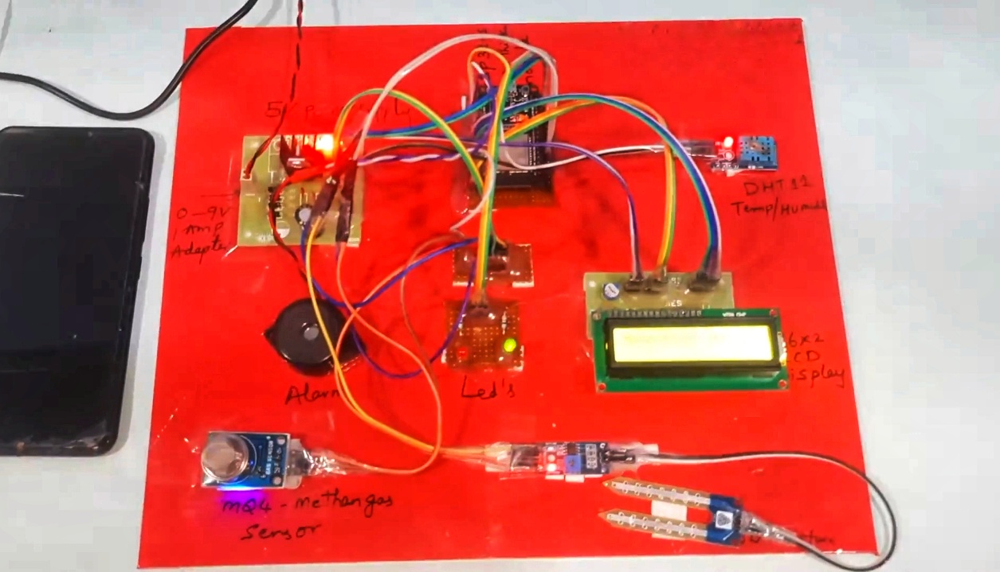
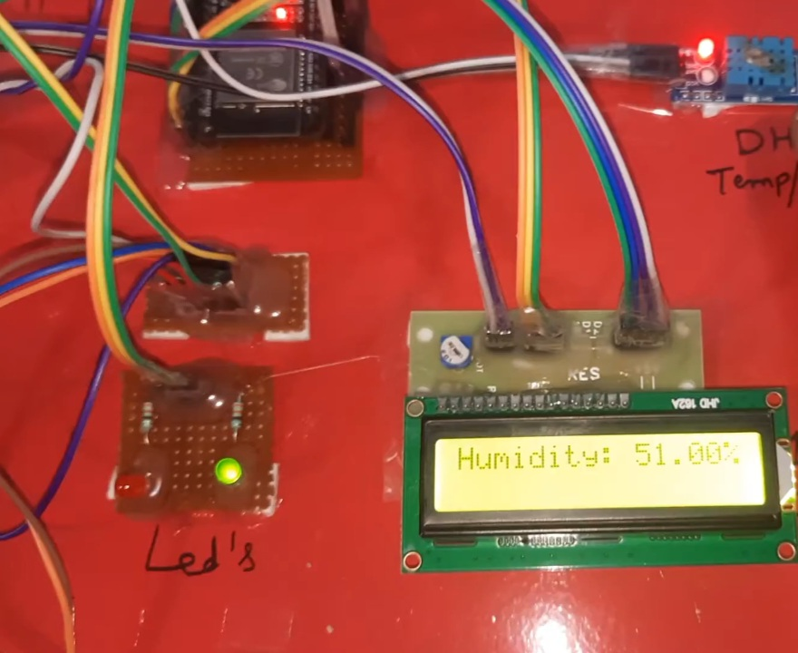
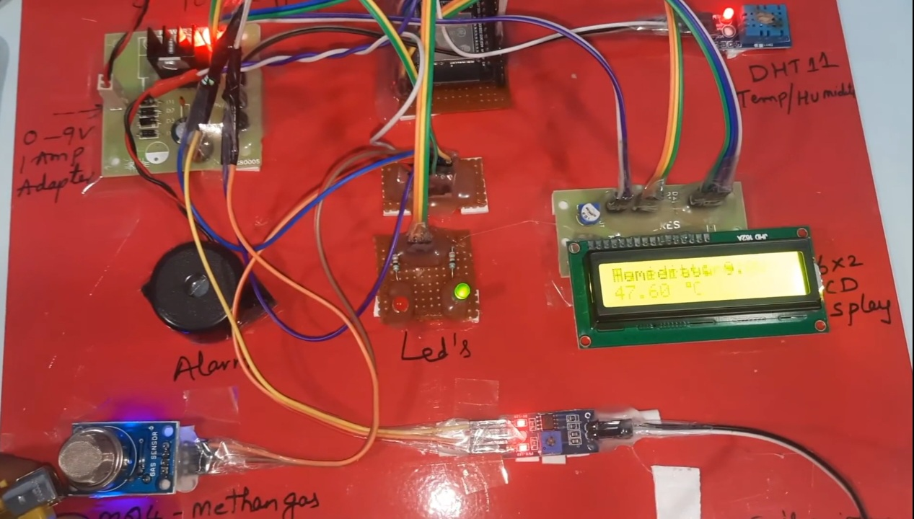
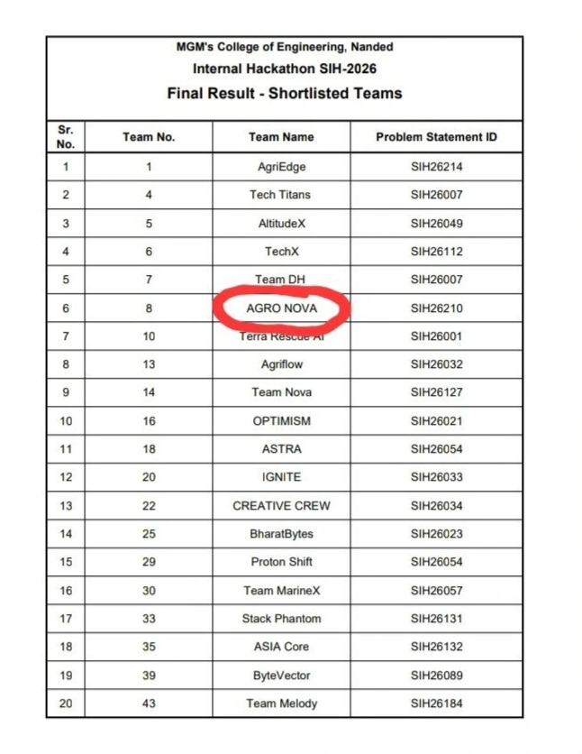
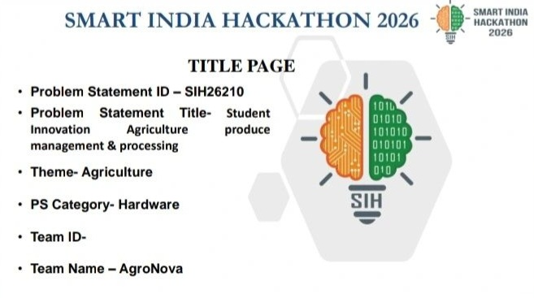
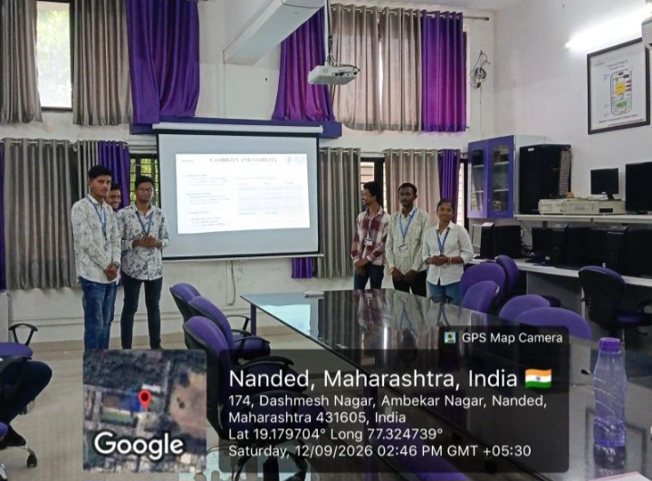

# 🌾 Smart Storage Monitoring System
### IoT-Based Agriculture Produce Spoilage Alert System

**Team Name:** Agronova  
**Competition:** Smart India Hackathon (SIH) 2026  
**Problem Statement ID:** SIH26214  
**Theme:** Agriculture & Rural Development  
**Project Type:** Hardware / Internet of Things (IoT)

---

## 📌 Project Overview

The Smart Storage Monitoring System is an IoT-based solution designed to monitor the storage conditions of agricultural produce and provide early warnings about possible spoilage.

The system monitors important environmental parameters such as temperature, humidity, and spoilage-related gases inside a storage environment. When abnormal conditions are detected, the system can alert the user through an LED indicator, buzzer, or mobile notification, depending on the implemented hardware and software.

Our goal is to help farmers reduce post-harvest losses, improve storage management, and maintain the quality of fruits and vegetables.

## ❗ Problem Statement

Agricultural produce can deteriorate during storage because of unsuitable temperature, excessive humidity, poor ventilation, and gases released during ripening or spoilage.

Traditional storage methods may not provide continuous monitoring or timely warnings. This can lead to avoidable losses for farmers and other stakeholders in the agricultural supply chain.

## 💡 Proposed Solution

We propose a low-cost, sensor-based monitoring system that:

- Monitors temperature and humidity inside a storage box.
- Detects selected gases associated with produce ripening or spoilage.
- Identifies abnormal sensor readings using programmed threshold values.
- Activates an LED and buzzer when a warning condition is detected.
- Supports mobile alerts when connectivity and notification features are implemented.
- Helps users make timely decisions about storage conditions.

## ⚙️ Working Principle

1. Sensors collect environmental data from the storage area.
2. A microcontroller, such as an Arduino or ESP32, processes the readings.
3. The readings are compared with configured threshold values.
4. If an abnormal condition is detected, the system activates a warning.
5. If connected communication features are implemented, an alert can be sent to a mobile device.
6. The user checks the storage conditions and takes appropriate action.

## 🧰 Hardware Components

The final component selection depends on the prototype design.

- Arduino or ESP32 microcontroller
- Temperature and humidity sensor
- Suitable gas sensor
- LED indicators
- Buzzer
- Power supply
- Connecting wires and breadboard
- Storage box or prototype enclosure
- Wi-Fi or other communication facility, if required

## 🧪 Testing Plan

The prototype can be evaluated under three test conditions:

| Test Case | Purpose |
|---|---|
| Healthy Produce | Establish baseline sensor readings |
| Early Deterioration | Observe changes in environmental readings |
| Spoilage Suspected | Check whether configured warning conditions activate |

**Note:** Sensor readings alone may not conclusively establish that produce is rotten. Testing and calibration are required for reliable results.

## 🎯 Objectives

- Develop an affordable agricultural storage monitoring prototype.
- Provide early warnings about potentially unsuitable storage conditions.
- Explore IoT-based monitoring for agricultural applications.
- Support better post-harvest storage practices.
- Develop a prototype that can be tested and improved.

## 🌍 Expected Impact

- Better awareness of storage conditions.
- Earlier identification of potentially harmful environmental changes.
- Support for reducing avoidable post-harvest losses.
- Potential application in small farms, storage rooms, and produce containers.

The actual impact will depend on prototype validation, sensor accuracy, and field testing.

## 🚀 Future Scope

- Real-time mobile dashboard.
- Cloud-based data logging.
- SMS or app notifications.
- Crop-specific monitoring thresholds.
- Data analysis for storage-condition trends.
- Testing with different fruits and vegetables.
- Solar-powered operation for suitable use cases.

## 👨‍💻 Team Agronova

**Team Members:**

1. Shivam Kandkurte
2. Shaikh Fahad
3. Ashish Kotalwar
4. Amruta Jilhewar
5. Onkar Purjalkar
6. Shubham Rajurwar

**Institution:** MGM College of Engineering, Nanded, Maharashtra, India

## 📂 Project Status

Currently developing and documenting the project prototype.

Hardware implementation, sensor calibration, testing results, and demonstration materials will be added as they become available.

## 🤝 Acknowledgement

This project is being developed for Smart India Hackathon 2026 with the aim of exploring practical IoT applications in agriculture.

---

**Developed by Team Agronova** 🌱

## 📸 Project Gallery

### 1. Project Prototype

### 2. Project Photo

### 3. Project Demonstration

### 4. Project Update

### 5. Project Showcase

### 6. Project Gallery

